# TownTrack — Mobile Mermaid Wireframes

## ขอบเขตและต้นฉบับที่ใช้

- ขนาดอ้างอิง **iPhone 16 Pro Max 440 × 956 pt**; วางแถบระบบและ Dynamic Island ไว้เหนือเนื้อหา, เว้น Safe Area ด้านบน/ล่าง และให้เนื้อหายาวเลื่อนในแนวตั้ง
- อ้างอิง UI ปัจจุบันจาก `src/main.jsx`, `src/Citizen.jsx`, `src/PublicDashboard.jsx`, `src/EmergencyPage.jsx`, `src/Office.jsx`, `src/components.jsx`, `src/PublicInformation.jsx` และใช้ `wireframes/ios-towntrack.html` เพื่อตรวจความต่างจากร่างเดิม
- Mermaid แสดง **ลำดับและกลุ่มองค์ประกอบ** ไม่ใช่พิกัดระดับพิกเซล; `HEADER` อยู่บน, `CONTENT` เลื่อนแนวตั้ง, `NAV` อยู่ในแผงที่เปิดด้วยเมนูสามขีด หรือท้ายหน้าตามต้นฉบับปัจจุบัน
- โทน Low-Fidelity: ขาว เทา ดำเท่านั้น; ค่าตัวเลขในบัตรเรื่องเป็นข้อมูลแปรตามคำร้อง ไม่สร้างเลขหรือข้อความเหตุการณ์ใหม่
- ในหน้าคิวบุคลากร Desktop มีรายการซ้ายและรายละเอียดขวา; บนมือถือแปลงเป็น **คิว → รายละเอียด → กลับไปที่รายการ** โดยเก็บตัวกรอง, ข้อมูลบัตร และคำสั่งทั้งหมด

### ความต่างจากไฟล์ wireframe รุ่นเก่าที่ต้องยืนยัน

1. `wireframes/ios-towntrack.html` ยังมีตัวเลือกความเร่งด่วนของประชาชนรวมถึง “ฉุกเฉิน”, ขั้น “ตรวจสอบก่อนส่ง”, เมนูด้านล่าง และปุ่ม “รวมกับเรื่อง / แยกเป็น 2 เรื่อง”; UI และกติกาปัจจุบันไม่มีขั้นหรือคำสั่งเหล่านี้ เจ้าหน้าที่รับเรื่องเป็นผู้ประเมินระดับทั่วไป/เร่งด่วน จึงไม่ใส่ฟังก์ชันเก่าเป็นสิ่งที่ใช้งานได้ใน Wireframe ชุดนี้
2. หน้าปัจจุบันใช้ “เบอร์ช่วยเหลือ” สำหรับโทรศัพท์/หน่วยงานใกล้พิกัด แต่ไม่มีการแจ้งเหตุไฟไหม้ผ่านคำร้อง
3. หน้าติดตามปัจจุบันมีแบบประเมินหลังปิดเรื่อง ซึ่งไม่มีในไฟล์ wireframe รุ่นเก่า
4. หากต้องยึด HTML รุ่นเก่าแทน UI ปัจจุบัน ต้องยืนยันก่อนว่าฟังก์ชันที่หายไปควรกลับมาเป็นข้อกำหนดหรือเป็นเพียงร่างเก่า

## รายการหน้าจอที่พบ

| บทบาท | หน้าจอ |
| --- | --- |
| ประชาชน | C01 ทางเข้า LINE, C02 หน้าหลัก, C03 เมนู, C04 ตรวจเรื่องใกล้เคียง, C05 แจ้งปัญหา, C06 ส่งสำเร็จ, C07 ติดตาม, C08 รายละเอียด, C09 แก้ข้อมูล, C10 ประเมิน, C11 เบอร์ช่วยเหลือ |
| เจ้าหน้าที่รับเรื่อง | S01 OIDC, S02 ภาพรวมและคิว, S03 รายละเอียด, S04 ป๊อปอัปดำเนินการ, S05 ข้อเสนองบ, S06 ข้อเสนอคำสั่ง |
| หัวหน้าทีมภาคสนาม | T01 OIDC, T02 ภาพรวมและคิว, T03 รายละเอียด, T04 จัดทีม, T05 ข้อเสนอทรัพยากร, T06 ตรวจคุณภาพ, T07 ยืนยันใช้ทรัพยากรเดิม |
| เจ้าหน้าที่ภาคสนาม | W01 OIDC, W02 ภาพรวมและคิว, W03 ใบงาน, W04 ปฏิเสธ/ขอทรัพยากร, W05 รายงานผล |
| ผู้บริหาร / ผู้อนุมัติ | A01 OIDC, A02 ภาพรวมและคิว, A03 รายละเอียดข้อเสนอ, A04 บันทึกผล |
| ร่วมทุกบทบาท | L01 เลือกบทบาท, I01 คู่มือ, I02 ติดต่อ, I03 ข้อมูลส่วนบุคคล, I04 นโยบายเว็บไซต์, I05 ความมั่นคงปลอดภัย, I06 การเข้าถึง, I07 แผนผังเว็บไซต์ |

**วิธีอ่าน:** กรอบแต่ละกรอบเรียงจากบนลงล่างตามลำดับที่เห็นเมื่อเลื่อนจอ; `*` หมายถึงช่องบังคับ. คัดลอกเนื้อหาใน code block ใดก็ได้ไปยัง Mermaid Live Editor ได้โดยตรง. ป๊อปอัปและสถานะตามเงื่อนไขเป็นหน้าจอแยกเพื่อให้ตรวจได้ครบ.


## หน้าร่วม


### L01 หน้าเริ่มต้นและเลือกบทบาท

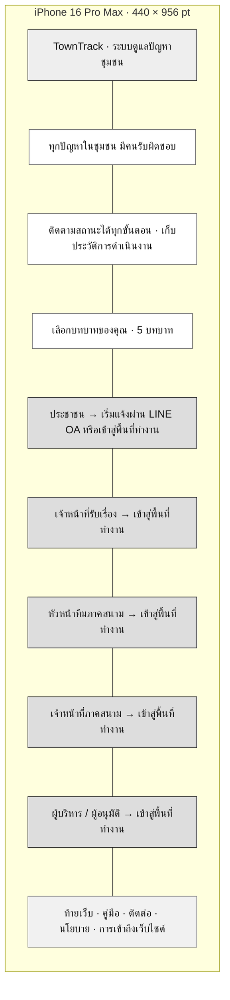


## ประชาชน


### C01 ทางเข้าผ่าน LINE OA

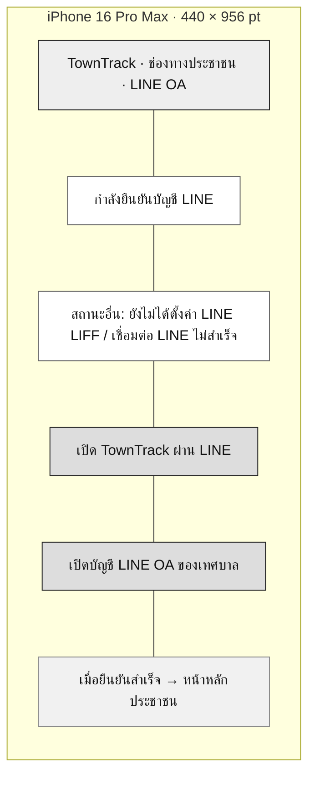


### C02 หน้าหลักและภาพรวมชุมชน

```mermaid
flowchart TB
  subgraph PHONE["iPhone 16 Pro Max · 440 × 956 pt"]
    direction TB
    N1["[☰] TownTrack · ประชาชน · [ดูเรื่องที่ติดตาม]"]
    N2["ทุกปัญหา มีความคืบหน้า · เทศบาลตำบลระแหง"]
    N3["ติดตามสถานะปัญหา · แจ้งปัญหาใหม่"]
    N4["เรื่องที่แจ้งทั้งหมด · เสียงสนับสนุนจากชุมชน"]
    N5["แก้ไขและปิดเรื่องแล้ว · สัดส่วนปิดเรื่อง"]
    N6["5 ปัญหาที่ชุมชนสนใจมากที่สุด · อันดับ / ภาพ / ชื่อเรื่อง / โหวต"]
    N7["สำรวจปัญหาในพื้นที่ · ค้นหาเลขเรื่อง ปัญหา หรือสถานที่"]
    N8["ประเภทปัญหา [ทุกประเภท] · เรียงตาม [แจ้งล่าสุด / เสียงสนับสนุน]"]
    N9["ล้างตัวกรอง · ดาวน์โหลดรายการ"]
    N10["ตำแหน่งปัญหา · แผนที่ / กลุ่ม / หมุด / ความหนาแน่น / ปัญหาใกล้ฉัน"]
    N11["สรุปภาพรวม · รอรับเรื่อง / ข้อมูล · กำลังดำเนินการ · รอพิจารณา · ปิดเรื่องแล้ว"]
    N12["รายการปัญหา · ภาพ · ประเภท · เลขเรื่อง · สถานะ · สถานที่ · วันที่ · ผลโหวต"]
    N13["ยืนยันปัญหา · ติดตาม · ดูเรื่อง"]
    N14["ดูเรื่องเพิ่ม · ย่อรายการ"]
    N15["เลื่อนหน้าจอเพื่อดูรายการต่อ · ท้ายเว็บข้อมูลบริการ"]
    N1 --- N2 --- N3 --- N4 --- N5 --- N6 --- N7 --- N8 --- N9 --- N10 --- N11 --- N12 --- N13 --- N14 --- N15
  end
  classDef header fill:#eeeeee,stroke:#222222,color:#111111;
  classDef content fill:#ffffff,stroke:#666666,color:#111111;
  classDef field fill:#f5f5f5,stroke:#555555,color:#111111;
  classDef button fill:#dddddd,stroke:#222222,color:#111111;
  classDef nav fill:#f1f1f1,stroke:#888888,color:#111111;
  class N1 header;
  class N2,N4,N5,N6,N7,N8,N10,N11,N12 content;
  class N3,N9,N13,N14 button;
  class N15 nav;
```


### C03 เมนูสามขีด

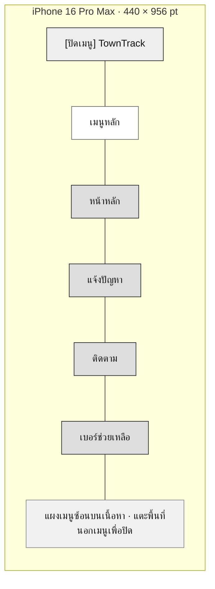


### C04 ตรวจปัญหาใกล้จุดเกิดเหตุ

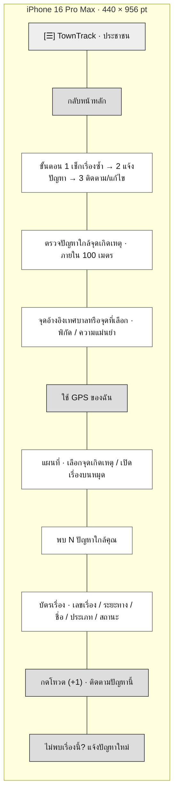


### C05 แบบฟอร์มแจ้งปัญหา

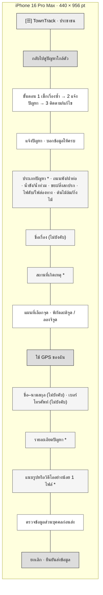


### C06 ส่งคำร้องสำเร็จ

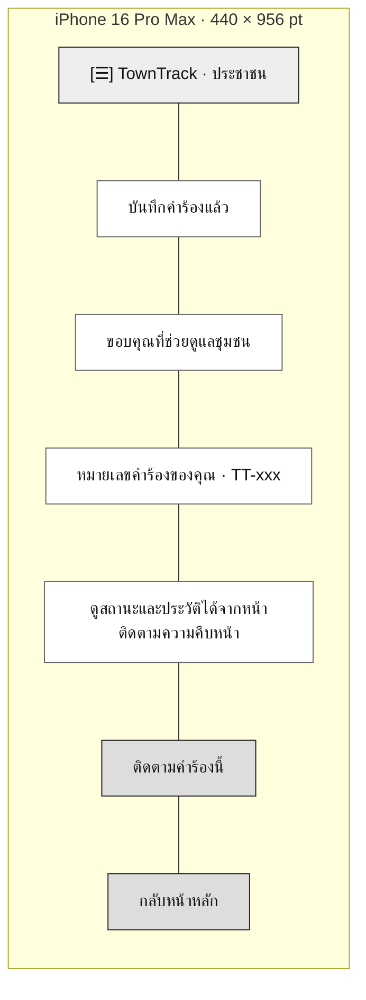


### C07 ติดตามสถานะปัญหา

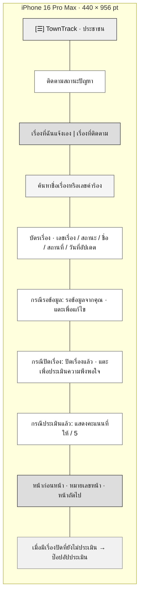


### C08 รายละเอียดเรื่องและความคืบหน้า

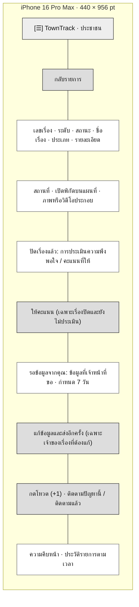


### C09 แก้ไขและส่งข้อมูลเพิ่มเติม

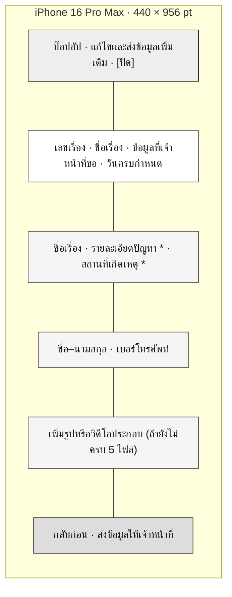


### C10 ประเมินความพึงพอใจ

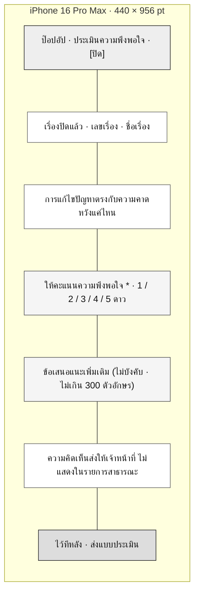


### C11 เบอร์ช่วยเหลือ

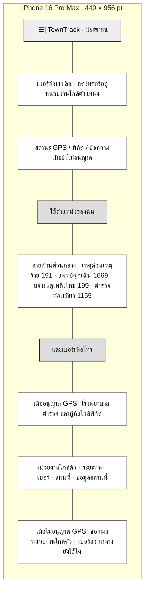


### Navigation Flow — ประชาชน

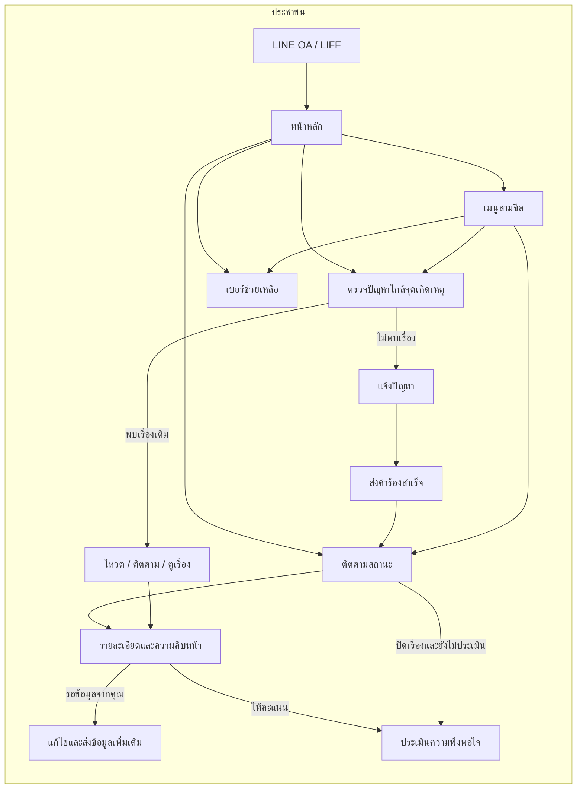


## เจ้าหน้าที่รับเรื่อง


### S01 เข้าสู่ระบบ OIDC

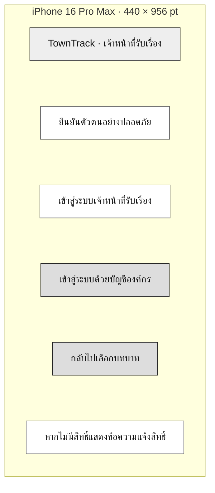


### S02 ภาพรวมและคิวรับเรื่อง

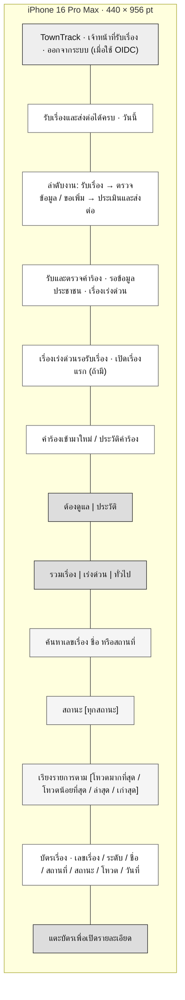


### S03 รายละเอียดคำร้อง

```mermaid
flowchart TB
  subgraph PHONE["iPhone 16 Pro Max · 440 × 956 pt"]
    direction TB
    N1["TownTrack · เจ้าหน้าที่รับเรื่อง"]
    N2["กลับไปที่รายการ"]
    N3["เลขเรื่อง · ระดับ · สถานะ · ชื่อเรื่อง · ประเภท · รายละเอียด"]
    N4["สถานที่ · พิกัด / แผนที่ · ข้อมูลติดต่อผู้แจ้ง · ภาพ/วิดีโอ"]
    N5["ข้อเสนอ / ผลพิจารณา / รายงานและหลักฐาน (ถ้ามี)"]
    N6["ผลประเมินความพึงพอใจ (เมื่อมี)"]
    N7["ดำเนินการขั้นถัดไป · ปุ่มตามสถานะ"]
    N8["รับคำร้อง / ปฏิเสธคำร้อง (เรื่องใหม่)"]
    N9["ข้อมูลไม่ครบ · ขอให้ประชาชนแก้ไข / ประเมินความเร่งด่วน"]
    N10["ไม่ต้อง · มอบหมายหัวหน้าทีม / ต้องใช้ · จัดทำข้อเสนองบ"]
    N11["เสนอคำสั่งตามกฎหมาย / ข้อพิพาท"]
    N12["อนุมัติแล้ว: บันทึกหลักฐานพร้อมใช้ · มอบหมายหัวหน้าทีม"]
    N13["ออกคำสั่งแล้ว: มอบหมายติดตามผลคำสั่ง"]
    N14["ถูกขอข้อมูลเพิ่ม: เพิ่มเติมและส่งข้อเสนอฉบับใหม่"]
    N15["ผ่าน · ปิดเรื่อง / ยังไม่ผ่าน · ส่งกลับแก้ไข (รอตรวจสุดท้าย)"]
    N16["ประวัติรายการ · เปิด/ย่อขั้นตอน"]
    N1 --- N2 --- N3 --- N4 --- N5 --- N6 --- N7 --- N8 --- N9 --- N10 --- N11 --- N12 --- N13 --- N14 --- N15 --- N16
  end
  classDef header fill:#eeeeee,stroke:#222222,color:#111111;
  classDef content fill:#ffffff,stroke:#666666,color:#111111;
  classDef field fill:#f5f5f5,stroke:#555555,color:#111111;
  classDef button fill:#dddddd,stroke:#222222,color:#111111;
  classDef nav fill:#f1f1f1,stroke:#888888,color:#111111;
  class N1 header;
  class N3,N4,N5,N6,N7,N16 content;
  class N2,N8,N9,N10,N11,N12,N13,N14,N15 button;
```


### S04 ป๊อปอัปดำเนินการรับเรื่อง

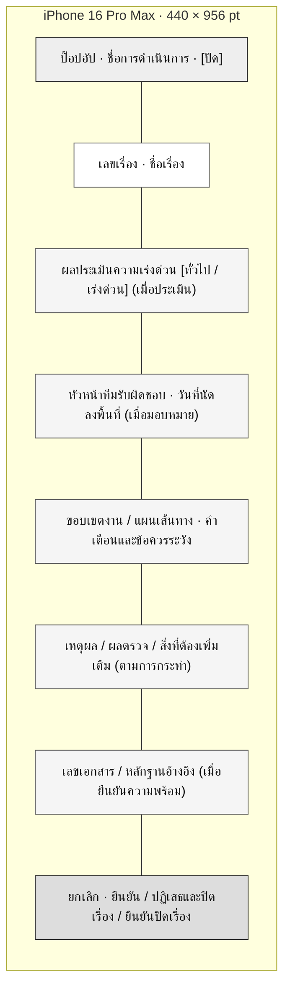


### S05 ข้อเสนอขอใช้งบประมาณ / ทรัพยากร

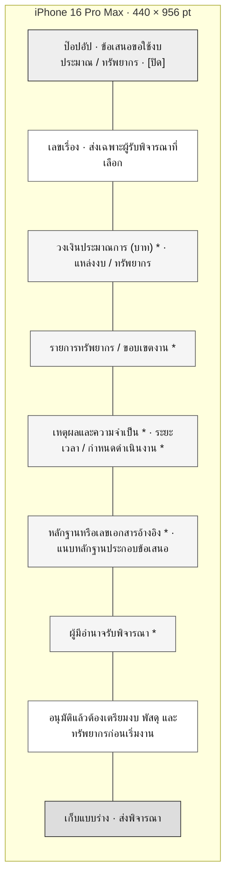


### S06 เสนอคำสั่งตามกฎหมาย / ข้อพิพาท

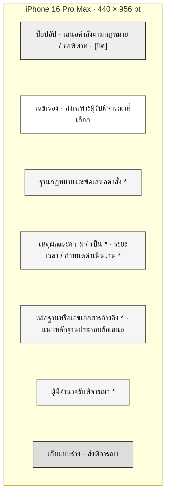


### Navigation Flow — เจ้าหน้าที่รับเรื่อง

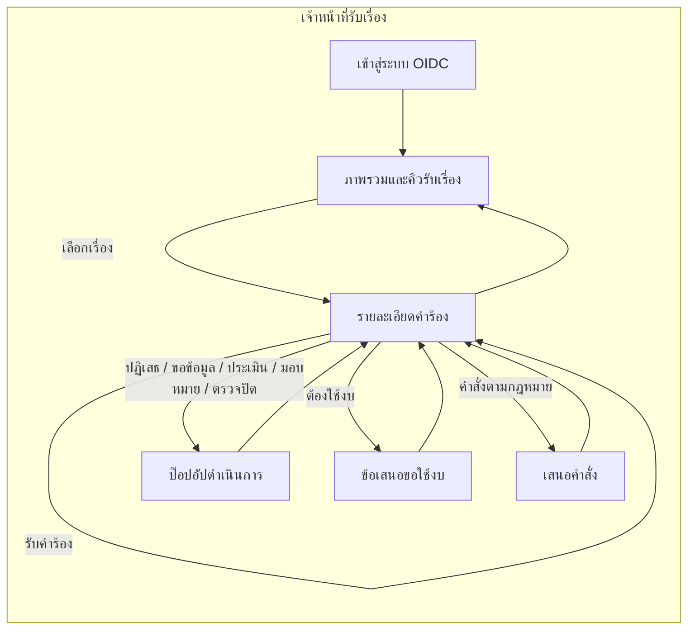


## หัวหน้าทีมภาคสนาม


### T01 เข้าสู่ระบบ OIDC

```mermaid
flowchart TB
  subgraph PHONE["iPhone 16 Pro Max · 440 × 956 pt"]
    direction TB
    N1["TownTrack · หัวหน้าทีมภาคสนาม"]
    N2["ยืนยันตัวตนอย่างปลอดภัย"]
    N3["เข้าสู่ระบบหัวหน้าทีมภาคสนาม"]
    N4["เข้าสู่ระบบด้วยบัญชีองค์กร"]
    N5["กลับไปเลือกบทบาท"]
    N1 --- N2 --- N3 --- N4 --- N5
  end
  classDef header fill:#eeeeee,stroke:#222222,color:#111111;
  classDef content fill:#ffffff,stroke:#666666,color:#111111;
  classDef field fill:#f5f5f5,stroke:#555555,color:#111111;
  classDef button fill:#dddddd,stroke:#222222,color:#111111;
  classDef nav fill:#f1f1f1,stroke:#888888,color:#111111;
  class N1 header;
  class N2,N3 content;
  class N4,N5 button;
```


### T02 ภาพรวมและคิวงานทีม

```mermaid
flowchart TB
  subgraph PHONE["iPhone 16 Pro Max · 440 × 956 pt"]
    direction TB
    N1["TownTrack · หัวหน้าทีมภาคสนาม · บัญชีทดลอง (โหมดสาธิต) · ออกจากระบบ (เมื่อใช้ OIDC)"]
    N2["วางแผนงาน ดูแลทีม · วันนี้"]
    N3["ลำดับงาน: วางแผน → จัดทีม → ตรวจคุณภาพ"]
    N4["รอจัดทีม · รอตรวจงาน · ขอทรัพยากร"]
    N5["งานที่ต้องจัดทีม / ประวัติงานทีม"]
    N6["ต้องดูแล | ประวัติ · รวมเรื่อง | เร่งด่วน | ทั่วไป"]
    N7["ค้นหาเลขเรื่อง ชื่อ หรือสถานที่"]
    N8["สถานะ [ทุกสถานะ] · วันที่นัดลงพื้นที่"]
    N9["เรียงรายการตาม [โหวตมากที่สุด / โหวตน้อยที่สุด / ล่าสุด / เก่าสุด]"]
    N10["บัตรเรื่อง · เลขเรื่อง / ระดับ / ชื่อ / สถานที่ / สถานะ / โหวต / วันที่"]
    N11["แตะบัตรเพื่อเปิดรายละเอียด"]
    N1 --- N2 --- N3 --- N4 --- N5 --- N6 --- N7 --- N8 --- N9 --- N10 --- N11
  end
  classDef header fill:#eeeeee,stroke:#222222,color:#111111;
  classDef content fill:#ffffff,stroke:#666666,color:#111111;
  classDef field fill:#f5f5f5,stroke:#555555,color:#111111;
  classDef button fill:#dddddd,stroke:#222222,color:#111111;
  classDef nav fill:#f1f1f1,stroke:#888888,color:#111111;
  class N1 header;
  class N2,N3,N4,N5,N10 content;
  class N7,N8,N9 field;
  class N6,N11 button;
```


### T03 รายละเอียดแผนงาน

```mermaid
flowchart TB
  subgraph PHONE["iPhone 16 Pro Max · 440 × 956 pt"]
    direction TB
    N1["TownTrack · หัวหน้าทีมภาคสนาม"]
    N2["กลับไปที่รายการ"]
    N3["เลขเรื่อง · ระดับ · สถานะ · ชื่อ / รายละเอียด / สถานที่ / แผนที่"]
    N4["ข้อมูลติดต่อผู้แจ้ง · ภาพ/วิดีโอ"]
    N5["แผนและขอบเขตงาน · วันที่นัดลงพื้นที่ · คำเตือน"]
    N6["ข้อเสนอ / รายงาน / ผลพิจารณา / ผลประเมิน (ถ้ามี)"]
    N7["ดำเนินการขั้นถัดไป · ปุ่มตามสถานะ"]
    N8["มอบหมายทีมผู้ลงพื้นที่ / ต้องใช้ทรัพยากรเพิ่ม · เสนอขออนุมัติ"]
    N9["ไม่ต้องใช้เพิ่ม · ให้ทีมทำงานต่อ (เมื่อทีมขอทรัพยากร)"]
    N10["ผ่าน · ส่งเทศบาลตรวจปิด / ไม่ผ่าน · ให้แก้ไข (รอตรวจคุณภาพ)"]
    N11["ประวัติรายการ · เปิด/ย่อขั้นตอน"]
    N1 --- N2 --- N3 --- N4 --- N5 --- N6 --- N7 --- N8 --- N9 --- N10 --- N11
  end
  classDef header fill:#eeeeee,stroke:#222222,color:#111111;
  classDef content fill:#ffffff,stroke:#666666,color:#111111;
  classDef field fill:#f5f5f5,stroke:#555555,color:#111111;
  classDef button fill:#dddddd,stroke:#222222,color:#111111;
  classDef nav fill:#f1f1f1,stroke:#888888,color:#111111;
  class N1 header;
  class N3,N4,N5,N6,N7,N11 content;
  class N2,N8,N9,N10 button;
```


### T04 ป๊อปอัปจัดทีมและมอบหมายงาน

```mermaid
flowchart TB
  subgraph PHONE["iPhone 16 Pro Max · 440 × 956 pt"]
    direction TB
    N1["ป๊อปอัป · จัดทีมและมอบหมายงาน · [ปิด]"]
    N2["เลขเรื่อง · ชื่อเรื่อง"]
    N3["ผู้ลงพื้นที่ *"]
    N4["วันที่นัดลงพื้นที่"]
    N5["ยกเลิก · ยืนยัน"]
    N1 --- N2 --- N3 --- N4 --- N5
  end
  classDef header fill:#eeeeee,stroke:#222222,color:#111111;
  classDef content fill:#ffffff,stroke:#666666,color:#111111;
  classDef field fill:#f5f5f5,stroke:#555555,color:#111111;
  classDef button fill:#dddddd,stroke:#222222,color:#111111;
  classDef nav fill:#f1f1f1,stroke:#888888,color:#111111;
  class N1 header;
  class N2 content;
  class N3,N4 field;
  class N5 button;
```


### T05 ข้อเสนอขอทรัพยากรเพิ่ม

```mermaid
flowchart TB
  subgraph PHONE["iPhone 16 Pro Max · 440 × 956 pt"]
    direction TB
    N1["ป๊อปอัป · ข้อเสนอขอใช้งบประมาณ / ทรัพยากร · [ปิด]"]
    N2["วงเงินประมาณการ (บาท) * · แหล่งงบ / ทรัพยากร"]
    N3["รายการทรัพยากร / ขอบเขตงาน *"]
    N4["เหตุผลและความจำเป็น * · ระยะเวลา / กำหนดดำเนินงาน *"]
    N5["หลักฐานหรือเลขเอกสารอ้างอิง * · แนบหลักฐานประกอบข้อเสนอ"]
    N6["ผู้มีอำนาจรับพิจารณา *"]
    N7["เก็บแบบร่าง · ส่งพิจารณา"]
    N1 --- N2 --- N3 --- N4 --- N5 --- N6 --- N7
  end
  classDef header fill:#eeeeee,stroke:#222222,color:#111111;
  classDef content fill:#ffffff,stroke:#666666,color:#111111;
  classDef field fill:#f5f5f5,stroke:#555555,color:#111111;
  classDef button fill:#dddddd,stroke:#222222,color:#111111;
  classDef nav fill:#f1f1f1,stroke:#888888,color:#111111;
  class N1 header;
  class N2,N3,N4,N5,N6 field;
  class N7 button;
```


### T06 ป๊อปอัปตรวจคุณภาพ

```mermaid
flowchart TB
  subgraph PHONE["iPhone 16 Pro Max · 440 × 956 pt"]
    direction TB
    N1["ป๊อปอัป · ยืนยันผลตรวจคุณภาพ / ส่งกลับให้ทีมแก้ไข · [ปิด]"]
    N2["เลขเรื่อง · ชื่อเรื่อง · รายงานและหลักฐานก่อน/หลัง"]
    N3["เหตุผล / ผลตรวจ / สิ่งที่ต้องแก้ไข *"]
    N4["ยกเลิก · ผ่าน · ส่งให้เทศบาลตรวจปิด"]
    N5["ไม่ผ่าน · ให้แก้ไข"]
    N1 --- N2 --- N3 --- N4 --- N5
  end
  classDef header fill:#eeeeee,stroke:#222222,color:#111111;
  classDef content fill:#ffffff,stroke:#666666,color:#111111;
  classDef field fill:#f5f5f5,stroke:#555555,color:#111111;
  classDef button fill:#dddddd,stroke:#222222,color:#111111;
  classDef nav fill:#f1f1f1,stroke:#888888,color:#111111;
  class N1 header;
  class N2 content;
  class N3 field;
  class N4,N5 button;
```


### T07 ป๊อปอัปยืนยันใช้ทรัพยากรเดิม

```mermaid
flowchart TB
  subgraph PHONE["iPhone 16 Pro Max · 440 × 956 pt"]
    direction TB
    N1["ป๊อปอัป · ประเมินว่าใช้ทรัพยากรเดิมได้ · [ปิด]"]
    N2["เลขเรื่อง · ชื่อเรื่อง · คำขอทรัพยากรจากทีม"]
    N3["เหตุผลที่ไม่ต้องขอทรัพยากรเพิ่ม *"]
    N4["ยกเลิก · ยืนยัน"]
    N1 --- N2 --- N3 --- N4
  end
  classDef header fill:#eeeeee,stroke:#222222,color:#111111;
  classDef content fill:#ffffff,stroke:#666666,color:#111111;
  classDef field fill:#f5f5f5,stroke:#555555,color:#111111;
  classDef button fill:#dddddd,stroke:#222222,color:#111111;
  class N1 header;
  class N2 content;
  class N3 field;
  class N4 button;
```

### Navigation Flow — หัวหน้าทีมภาคสนาม

```mermaid
flowchart LR
  subgraph T["หัวหน้าทีมภาคสนาม"]
    T0["เข้าสู่ระบบ OIDC"] --> T1["ภาพรวมและคิวงานทีม"]
    T1 --> T2["รายละเอียดแผนงาน"]
    T2 -->|"มอบหมายทีม"| T3["ป๊อปอัปจัดทีม"]
    T2 -->|"ต้องใช้ทรัพยากรเพิ่ม"| T4["ข้อเสนอขอทรัพยากร"]
    T2 -->|"รอตรวจคุณภาพ"| T5["ป๊อปอัปตรวจคุณภาพ"]
    T2 -->|"ใช้ทรัพยากรเดิมได้"| T6["ป๊อปอัปยืนยันเหตุผล"]
    T3 --> T2
    T4 --> T2
    T5 --> T2
    T6 --> T2
    T2 --> T1
  end
```


## เจ้าหน้าที่ภาคสนาม


### W01 เข้าสู่ระบบ OIDC

```mermaid
flowchart TB
  subgraph PHONE["iPhone 16 Pro Max · 440 × 956 pt"]
    direction TB
    N1["TownTrack · เจ้าหน้าที่ภาคสนาม"]
    N2["ยืนยันตัวตนอย่างปลอดภัย"]
    N3["เข้าสู่ระบบเจ้าหน้าที่ภาคสนาม"]
    N4["เข้าสู่ระบบด้วยบัญชีองค์กร"]
    N5["กลับไปเลือกบทบาท"]
    N1 --- N2 --- N3 --- N4 --- N5
  end
  classDef header fill:#eeeeee,stroke:#222222,color:#111111;
  classDef content fill:#ffffff,stroke:#666666,color:#111111;
  classDef field fill:#f5f5f5,stroke:#555555,color:#111111;
  classDef button fill:#dddddd,stroke:#222222,color:#111111;
  classDef nav fill:#f1f1f1,stroke:#888888,color:#111111;
  class N1 header;
  class N2,N3 content;
  class N4,N5 button;
```


### W02 งานภาคสนามและเส้นทางวันนี้

```mermaid
flowchart TB
  subgraph PHONE["iPhone 16 Pro Max · 440 × 956 pt"]
    direction TB
    N1["TownTrack · เจ้าหน้าที่ภาคสนาม · บัญชีทดลอง (โหมดสาธิต) · ออกจากระบบ (เมื่อใช้ OIDC)"]
    N2["งานที่ได้รับมอบหมาย · วันนี้"]
    N3["ลำดับงาน: รับงาน → ลงพื้นที่ → ส่งหลักฐาน"]
    N4["นัดวันนี้ · รอรับงาน · กำลังทำ"]
    N5["เส้นทางและงานวันนี้ / งานที่เสร็จแล้ว"]
    N6["ต้องดูแล | ประวัติ · รวมเรื่อง | เร่งด่วน | ทั่วไป"]
    N7["ค้นหาเลขเรื่อง ชื่อ หรือสถานที่"]
    N8["สถานะ [ทุกสถานะ] · วันที่นัดลงพื้นที่"]
    N9["เรียงรายการตาม [โหวตมากที่สุด / โหวตน้อยที่สุด / ล่าสุด / เก่าสุด]"]
    N10["บัตรเรื่อง · เลขเรื่อง / ระดับ / ชื่อ / สถานที่ / สถานะ / โหวต / วันนัด"]
    N11["แตะบัตรเพื่อเปิดใบงาน"]
    N1 --- N2 --- N3 --- N4 --- N5 --- N6 --- N7 --- N8 --- N9 --- N10 --- N11
  end
  classDef header fill:#eeeeee,stroke:#222222,color:#111111;
  classDef content fill:#ffffff,stroke:#666666,color:#111111;
  classDef field fill:#f5f5f5,stroke:#555555,color:#111111;
  classDef button fill:#dddddd,stroke:#222222,color:#111111;
  classDef nav fill:#f1f1f1,stroke:#888888,color:#111111;
  class N1 header;
  class N2,N3,N4,N5,N10 content;
  class N7,N8,N9 field;
  class N6,N11 button;
```


### W03 รายละเอียดใบงานภาคสนาม

```mermaid
flowchart TB
  subgraph PHONE["iPhone 16 Pro Max · 440 × 956 pt"]
    direction TB
    N1["TownTrack · เจ้าหน้าที่ภาคสนาม"]
    N2["กลับไปที่รายการ"]
    N3["เลขเรื่อง · ระดับ · สถานะ · ชื่อ / รายละเอียด / สถานที่"]
    N4["เปิดพิกัดบนแผนที่ · ข้อมูลติดต่อผู้แจ้ง · ภาพ/วิดีโอ"]
    N5["แผนลงพื้นที่ · วันนัด · คำเตือนและข้อควรระวัง"]
    N6["ข้อเสนอ / รายงาน / ผลประเมิน (ถ้ามี)"]
    N7["ดำเนินการขั้นถัดไป · ปุ่มตามสถานะ"]
    N8["กดรับงาน · กดปฏิเสธงาน (ยังไม่รับ)"]
    N9["เริ่มปฏิบัติงาน · ขอใช้ทรัพยากรเพิ่ม (รับแล้ว)"]
    N10["ส่งรายงานพร้อมภาพก่อน / หลัง (กำลังทำ)"]
    N11["ประวัติรายการ · เปิด/ย่อขั้นตอน"]
    N1 --- N2 --- N3 --- N4 --- N5 --- N6 --- N7 --- N8 --- N9 --- N10 --- N11
  end
  classDef header fill:#eeeeee,stroke:#222222,color:#111111;
  classDef content fill:#ffffff,stroke:#666666,color:#111111;
  classDef field fill:#f5f5f5,stroke:#555555,color:#111111;
  classDef button fill:#dddddd,stroke:#222222,color:#111111;
  classDef nav fill:#f1f1f1,stroke:#888888,color:#111111;
  class N1 header;
  class N3,N4,N5,N6,N7,N11 content;
  class N2,N8,N9,N10 button;
```


### W04 ป๊อปอัปปฏิเสธงานหรือขอทรัพยากร

```mermaid
flowchart TB
  subgraph PHONE["iPhone 16 Pro Max · 440 × 956 pt"]
    direction TB
    N1["ป๊อปอัป · ปฏิเสธงาน / ขอทรัพยากรเพิ่มเติม · [ปิด]"]
    N2["เลขเรื่อง · ชื่อเรื่อง"]
    N3["เหตุผลปฏิเสธเพื่อให้หัวหน้าจัดทีมใหม่ (เมื่อปฏิเสธ)"]
    N4["อุปกรณ์ / เครื่องจักร / วัสดุที่ต้องการ (เมื่อขอทรัพยากร)"]
    N5["ยกเลิก · ยืนยัน"]
    N1 --- N2 --- N3 --- N4 --- N5
  end
  classDef header fill:#eeeeee,stroke:#222222,color:#111111;
  classDef content fill:#ffffff,stroke:#666666,color:#111111;
  classDef field fill:#f5f5f5,stroke:#555555,color:#111111;
  classDef button fill:#dddddd,stroke:#222222,color:#111111;
  classDef nav fill:#f1f1f1,stroke:#888888,color:#111111;
  class N1 header;
  class N2 content;
  class N3,N4 field;
  class N5 button;
```


### W05 รายงานผลการปฏิบัติงาน

```mermaid
flowchart TB
  subgraph PHONE["iPhone 16 Pro Max · 440 × 956 pt"]
    direction TB
    N1["ป๊อปอัป · รายงานผลการปฏิบัติงาน · [ปิด]"]
    N2["เลขเรื่อง · ต้องแนบหลักฐานก่อนและหลังอย่างละ 1 ไฟล์ขึ้นไป"]
    N3["ผลที่พบ / การดำเนินงาน / ความปลอดภัย *"]
    N4["หลักฐานก่อนดำเนินการ *"]
    N5["หลักฐานหลังดำเนินการ *"]
    N6["ยกเลิก · ส่งรายงาน"]
    N1 --- N2 --- N3 --- N4 --- N5 --- N6
  end
  classDef header fill:#eeeeee,stroke:#222222,color:#111111;
  classDef content fill:#ffffff,stroke:#666666,color:#111111;
  classDef field fill:#f5f5f5,stroke:#555555,color:#111111;
  classDef button fill:#dddddd,stroke:#222222,color:#111111;
  classDef nav fill:#f1f1f1,stroke:#888888,color:#111111;
  class N1 header;
  class N2 content;
  class N3,N4,N5 field;
  class N6 button;
```


### Navigation Flow — เจ้าหน้าที่ภาคสนาม

```mermaid
flowchart LR
  subgraph W["เจ้าหน้าที่ภาคสนาม"]
    W0["เข้าสู่ระบบ OIDC"] --> W1["งานภาคสนามและเส้นทางวันนี้"]
    W1 --> W2["รายละเอียดใบงาน"]
    W2 -->|"รับงาน / เริ่มงาน"| W2
    W2 -->|"ปฏิเสธ / ขอทรัพยากร"| W3["ป๊อปอัปเหตุผล"]
    W2 -->|"กำลังทำ"| W4["รายงานผลพร้อมภาพก่อนหลัง"]
    W3 --> W2
    W4 --> W2
    W2 --> W1
  end
```


## ผู้บริหาร / ผู้อนุมัติ


### A01 เข้าสู่ระบบ OIDC

```mermaid
flowchart TB
  subgraph PHONE["iPhone 16 Pro Max · 440 × 956 pt"]
    direction TB
    N1["TownTrack · ผู้บริหาร / ผู้อนุมัติ"]
    N2["ยืนยันตัวตนอย่างปลอดภัย"]
    N3["เข้าสู่ระบบผู้บริหาร / ผู้อนุมัติ"]
    N4["เข้าสู่ระบบด้วยบัญชีองค์กร"]
    N5["กลับไปเลือกบทบาท"]
    N1 --- N2 --- N3 --- N4 --- N5
  end
  classDef header fill:#eeeeee,stroke:#222222,color:#111111;
  classDef content fill:#ffffff,stroke:#666666,color:#111111;
  classDef field fill:#f5f5f5,stroke:#555555,color:#111111;
  classDef button fill:#dddddd,stroke:#222222,color:#111111;
  classDef nav fill:#f1f1f1,stroke:#888888,color:#111111;
  class N1 header;
  class N2,N3 content;
  class N4,N5 button;
```


### A02 ภาพรวมและคิวพิจารณา

```mermaid
flowchart TB
  subgraph PHONE["iPhone 16 Pro Max · 440 × 956 pt"]
    direction TB
    N1["TownTrack · ผู้บริหาร / ผู้อนุมัติ · บัญชีทดลอง (โหมดสาธิต) · ออกจากระบบ (เมื่อใช้ OIDC)"]
    N2["ภาพรวมเพื่อการตัดสินใจ · วันนี้"]
    N3["ลำดับงาน: ตรวจข้อเสนอ → พิจารณา → บันทึกผล"]
    N4["รอพิจารณา · งบประมาณ · ข้อกฎหมาย"]
    N5["ภาพรวมเทศบาล · กราฟและสถิติ"]
    N6["ข้อเสนอที่รอพิจารณา / ผลการพิจารณา"]
    N7["ต้องดูแล | ประวัติ · รวมเรื่อง | เร่งด่วน | ทั่วไป"]
    N8["ค้นหาเลขเรื่อง ชื่อ หรือสถานที่"]
    N9["สถานะ [ทุกสถานะ]"]
    N10["เรียงรายการตาม [โหวตมากที่สุด / โหวตน้อยที่สุด / ล่าสุด / เก่าสุด]"]
    N11["บัตรเรื่อง · เลขเรื่อง / ระดับ / ชื่อ / สถานที่ / สถานะ / โหวต / วันที่"]
    N12["แตะบัตรเพื่อเปิดรายละเอียด"]
    N1 --- N2 --- N3 --- N4 --- N5 --- N6 --- N7 --- N8 --- N9 --- N10 --- N11 --- N12
  end
  classDef header fill:#eeeeee,stroke:#222222,color:#111111;
  classDef content fill:#ffffff,stroke:#666666,color:#111111;
  classDef field fill:#f5f5f5,stroke:#555555,color:#111111;
  classDef button fill:#dddddd,stroke:#222222,color:#111111;
  classDef nav fill:#f1f1f1,stroke:#888888,color:#111111;
  class N1 header;
  class N2,N3,N4,N5,N6,N11 content;
  class N8,N9,N10 field;
  class N7,N12 button;
```


### A03 รายละเอียดข้อเสนอ

```mermaid
flowchart TB
  subgraph PHONE["iPhone 16 Pro Max · 440 × 956 pt"]
    direction TB
    N1["TownTrack · ผู้บริหาร / ผู้อนุมัติ"]
    N2["กลับไปที่รายการ"]
    N3["เลขเรื่อง · ระดับ · สถานะ · ชื่อเรื่อง · ข้อมูลผู้แจ้ง · หลักฐาน"]
    N4["ข้อเสนอขอใช้งบประมาณ หรือ ข้อเสนอคำสั่งตามกฎหมาย · ฉบับที่"]
    N5["วงเงินประมาณการ (งบ) · รายการ / ขอบเขต · เหตุผล · ระยะเวลา"]
    N6["แหล่งงบ (ถ้ามี) · หลักฐานอ้างอิง · ผู้เสนอ · ไฟล์แนบ"]
    N7["ผลพิจารณาก่อนหน้า · รายงาน/ผลประเมิน (ถ้ามี)"]
    N8["ดำเนินการขั้นถัดไป"]
    N9["อนุมัติ / ไม่อนุมัติ / ขอข้อมูลเพิ่มเติม"]
    N10["ออกคำสั่งแจ้งคู่กรณี / ไม่ออกคำสั่ง · ยุติเรื่อง (กรณีกฎหมาย)"]
    N11["ประวัติรายการ · เปิด/ย่อขั้นตอน"]
    N1 --- N2 --- N3 --- N4 --- N5 --- N6 --- N7 --- N8 --- N9 --- N10 --- N11
  end
  classDef header fill:#eeeeee,stroke:#222222,color:#111111;
  classDef content fill:#ffffff,stroke:#666666,color:#111111;
  classDef field fill:#f5f5f5,stroke:#555555,color:#111111;
  classDef button fill:#dddddd,stroke:#222222,color:#111111;
  classDef nav fill:#f1f1f1,stroke:#888888,color:#111111;
  class N1 header;
  class N3,N4,N5,N6,N7,N8,N11 content;
  class N2,N9,N10 button;
```


### A04 ป๊อปอัปบันทึกผลพิจารณา

```mermaid
flowchart TB
  subgraph PHONE["iPhone 16 Pro Max · 440 × 956 pt"]
    direction TB
    N1["ป๊อปอัป · อนุมัติ / ไม่อนุมัติ / ขอข้อมูลเพิ่มเติม · [ปิด]"]
    N2["เลขเรื่อง · ชื่อเรื่อง · ประเภทข้อเสนอ"]
    N3["เหตุผล / ผลตรวจ / สิ่งที่ต้องเพิ่มเติม *"]
    N4["เลขเอกสาร / หลักฐานอ้างอิง * (กรณีอนุมัติหรือไม่อนุมัติ)"]
    N5["กรณีคำสั่งตามกฎหมาย: อ้างอิงเอกสารและการแจ้งคู่กรณีจริง"]
    N6["ยกเลิก · อนุมัติ / ยืนยันผลและปิดเรื่อง / ยืนยัน"]
    N1 --- N2 --- N3 --- N4 --- N5 --- N6
  end
  classDef header fill:#eeeeee,stroke:#222222,color:#111111;
  classDef content fill:#ffffff,stroke:#666666,color:#111111;
  classDef field fill:#f5f5f5,stroke:#555555,color:#111111;
  classDef button fill:#dddddd,stroke:#222222,color:#111111;
  classDef nav fill:#f1f1f1,stroke:#888888,color:#111111;
  class N1 header;
  class N2,N5 content;
  class N3,N4 field;
  class N6 button;
```


### Navigation Flow — ผู้บริหาร / ผู้อนุมัติ

```mermaid
flowchart LR
  subgraph A["ผู้บริหาร / ผู้อนุมัติ"]
    A0["เข้าสู่ระบบ OIDC"] --> A1["ภาพรวมและคิวพิจารณา"]
    A1 --> A2["รายละเอียดข้อเสนอ"]
    A2 -->|"อนุมัติ / ไม่อนุมัติ / ขอข้อมูล"| A3["ป๊อปอัปบันทึกผล"]
    A3 --> A2
    A2 --> A1
  end
```


## ข้อมูลบริการร่วมทุกบทบาท


### I01 คู่มือบริการ

```mermaid
flowchart TB
  subgraph PHONE["iPhone 16 Pro Max · 440 × 956 pt"]
    direction TB
    N1["TownTrack · ไทย | English"]
    N2["หน้าเริ่มต้น → คู่มือบริการ"]
    N3["ศูนย์ข้อมูลบริการ · คู่มือบริการ"]
    N4["เข้าสู่บริการประชาชน"]
    N5["เมนูหัวข้อ: คู่มือบริการ · ติดต่อหน่วยงาน · ข้อมูลส่วนบุคคล · นโยบายเว็บไซต์ · ความมั่นคงปลอดภัย · การเข้าถึงเว็บไซต์ · แผนผังเว็บไซต์"]
    N6["ขั้นตอนก่อนแจ้ง · เข้า LINE OA · ตรวจเรื่องใกล้เคียง · ส่งและติดตาม · เจ้าหน้าที่ดำเนินการ · ประเมินหลังปิดเรื่อง"]
    N7["ค้นหาในคู่มือ เช่น GPS · พิมพ์ / บันทึก PDF"]
    N8["ท้ายเว็บ · บริการและความช่วยเหลือ · นโยบายและการเข้าถึง"]
    N1 --- N2 --- N3 --- N4 --- N5 --- N6 --- N7 --- N8
  end
  classDef header fill:#eeeeee,stroke:#222222,color:#111111;
  classDef content fill:#ffffff,stroke:#666666,color:#111111;
  classDef field fill:#f5f5f5,stroke:#555555,color:#111111;
  classDef button fill:#dddddd,stroke:#222222,color:#111111;
  classDef nav fill:#f1f1f1,stroke:#888888,color:#111111;
  class N1 header;
  class N2,N3,N6 content;
  class N4,N7 button;
  class N5,N8 nav;
```


### I02 ติดต่อหน่วยงาน

```mermaid
flowchart TB
  subgraph PHONE["iPhone 16 Pro Max · 440 × 956 pt"]
    direction TB
    N1["TownTrack · ไทย | English"]
    N2["หน้าเริ่มต้น → ติดต่อหน่วยงาน"]
    N3["ศูนย์ข้อมูลบริการ · ติดต่อหน่วยงาน"]
    N4["เข้าสู่บริการประชาชน"]
    N5["เมนูหัวข้อ: คู่มือบริการ · ติดต่อหน่วยงาน · ข้อมูลส่วนบุคคล · นโยบายเว็บไซต์ · ความมั่นคงปลอดภัย · การเข้าถึงเว็บไซต์ · แผนผังเว็บไซต์"]
    N6["ช่องทางติดต่อและเสนอแนะ · โทรศัพท์ / อีเมล / เว็บไซต์ / LINE OA เมื่อหน่วยงานตั้งค่า"]
    N7["เปิดช่องทางติดต่อ"]
    N8["ท้ายเว็บ · บริการและความช่วยเหลือ · นโยบายและการเข้าถึง"]
    N1 --- N2 --- N3 --- N4 --- N5 --- N6 --- N7 --- N8
  end
  classDef header fill:#eeeeee,stroke:#222222,color:#111111;
  classDef content fill:#ffffff,stroke:#666666,color:#111111;
  classDef field fill:#f5f5f5,stroke:#555555,color:#111111;
  classDef button fill:#dddddd,stroke:#222222,color:#111111;
  classDef nav fill:#f1f1f1,stroke:#888888,color:#111111;
  class N1 header;
  class N2,N3,N6 content;
  class N4,N7 button;
  class N5,N8 nav;
```


### I03 ข้อมูลส่วนบุคคล

```mermaid
flowchart TB
  subgraph PHONE["iPhone 16 Pro Max · 440 × 956 pt"]
    direction TB
    N1["TownTrack · ไทย | English"]
    N2["หน้าเริ่มต้น → ข้อมูลส่วนบุคคล"]
    N3["ศูนย์ข้อมูลบริการ · ข้อมูลส่วนบุคคล"]
    N4["เข้าสู่บริการประชาชน"]
    N5["เมนูหัวข้อ: คู่มือบริการ · ติดต่อหน่วยงาน · ข้อมูลส่วนบุคคล · นโยบายเว็บไซต์ · ความมั่นคงปลอดภัย · การเข้าถึงเว็บไซต์ · แผนผังเว็บไซต์"]
    N6["ข้อมูลที่ระบบใช้ · พื้นที่จัดเก็บในต้นแบบ · บริการภายนอกและตำแหน่ง · ติดต่อเกี่ยวกับข้อมูลส่วนบุคคล"]
    N7["อ่านประกาศทางการของหน่วยงาน เมื่อมี URL"]
    N8["ท้ายเว็บ · บริการและความช่วยเหลือ · นโยบายและการเข้าถึง"]
    N1 --- N2 --- N3 --- N4 --- N5 --- N6 --- N7 --- N8
  end
  classDef header fill:#eeeeee,stroke:#222222,color:#111111;
  classDef content fill:#ffffff,stroke:#666666,color:#111111;
  classDef field fill:#f5f5f5,stroke:#555555,color:#111111;
  classDef button fill:#dddddd,stroke:#222222,color:#111111;
  classDef nav fill:#f1f1f1,stroke:#888888,color:#111111;
  class N1 header;
  class N2,N3,N6 content;
  class N4,N7 button;
  class N5,N8 nav;
```


### I04 นโยบายเว็บไซต์

```mermaid
flowchart TB
  subgraph PHONE["iPhone 16 Pro Max · 440 × 956 pt"]
    direction TB
    N1["TownTrack · ไทย | English"]
    N2["หน้าเริ่มต้น → นโยบายเว็บไซต์"]
    N3["ศูนย์ข้อมูลบริการ · นโยบายเว็บไซต์"]
    N4["เข้าสู่บริการประชาชน"]
    N5["เมนูหัวข้อ: คู่มือบริการ · ติดต่อหน่วยงาน · ข้อมูลส่วนบุคคล · นโยบายเว็บไซต์ · ความมั่นคงปลอดภัย · การเข้าถึงเว็บไซต์ · แผนผังเว็บไซต์"]
    N6["ขอบเขตบริการ · การใช้งานและความรับผิดชอบ · ลิขสิทธิ์และการนำข้อมูลไปใช้"]
    N7["อ่านประกาศทางการของหน่วยงาน เมื่อมี URL"]
    N8["ท้ายเว็บ · บริการและความช่วยเหลือ · นโยบายและการเข้าถึง"]
    N1 --- N2 --- N3 --- N4 --- N5 --- N6 --- N7 --- N8
  end
  classDef header fill:#eeeeee,stroke:#222222,color:#111111;
  classDef content fill:#ffffff,stroke:#666666,color:#111111;
  classDef field fill:#f5f5f5,stroke:#555555,color:#111111;
  classDef button fill:#dddddd,stroke:#222222,color:#111111;
  classDef nav fill:#f1f1f1,stroke:#888888,color:#111111;
  class N1 header;
  class N2,N3,N6 content;
  class N4,N7 button;
  class N5,N8 nav;
```


### I05 ความมั่นคงปลอดภัย

```mermaid
flowchart TB
  subgraph PHONE["iPhone 16 Pro Max · 440 × 956 pt"]
    direction TB
    N1["TownTrack · ไทย | English"]
    N2["หน้าเริ่มต้น → ความมั่นคงปลอดภัย"]
    N3["ศูนย์ข้อมูลบริการ · ความมั่นคงปลอดภัย"]
    N4["เข้าสู่บริการประชาชน"]
    N5["เมนูหัวข้อ: คู่มือบริการ · ติดต่อหน่วยงาน · ข้อมูลส่วนบุคคล · นโยบายเว็บไซต์ · ความมั่นคงปลอดภัย · การเข้าถึงเว็บไซต์ · แผนผังเว็บไซต์"]
    N6["การเข้าสู่ระบบ · ข้อมูลสาธิตและเครื่องที่ใช้ร่วมกัน · แจ้งปัญหาความปลอดภัย"]
    N7["อ่านประกาศทางการของหน่วยงาน เมื่อมี URL"]
    N8["ท้ายเว็บ · บริการและความช่วยเหลือ · นโยบายและการเข้าถึง"]
    N1 --- N2 --- N3 --- N4 --- N5 --- N6 --- N7 --- N8
  end
  classDef header fill:#eeeeee,stroke:#222222,color:#111111;
  classDef content fill:#ffffff,stroke:#666666,color:#111111;
  classDef field fill:#f5f5f5,stroke:#555555,color:#111111;
  classDef button fill:#dddddd,stroke:#222222,color:#111111;
  classDef nav fill:#f1f1f1,stroke:#888888,color:#111111;
  class N1 header;
  class N2,N3,N6 content;
  class N4,N7 button;
  class N5,N8 nav;
```


### I06 การเข้าถึงเว็บไซต์

```mermaid
flowchart TB
  subgraph PHONE["iPhone 16 Pro Max · 440 × 956 pt"]
    direction TB
    N1["TownTrack · ไทย | English"]
    N2["หน้าเริ่มต้น → การเข้าถึงเว็บไซต์"]
    N3["ศูนย์ข้อมูลบริการ · การเข้าถึงเว็บไซต์"]
    N4["เข้าสู่บริการประชาชน"]
    N5["เมนูหัวข้อ: คู่มือบริการ · ติดต่อหน่วยงาน · ข้อมูลส่วนบุคคล · นโยบายเว็บไซต์ · ความมั่นคงปลอดภัย · การเข้าถึงเว็บไซต์ · แผนผังเว็บไซต์"]
    N6["ปรับการอ่าน · ใช้คีย์บอร์ด · แผนที่และแบบฟอร์ม · อุปกรณ์และภาษา"]
    N7["เปิดการแสดงผล"]
    N8["ท้ายเว็บ · บริการและความช่วยเหลือ · นโยบายและการเข้าถึง"]
    N1 --- N2 --- N3 --- N4 --- N5 --- N6 --- N7 --- N8
  end
  classDef header fill:#eeeeee,stroke:#222222,color:#111111;
  classDef content fill:#ffffff,stroke:#666666,color:#111111;
  classDef field fill:#f5f5f5,stroke:#555555,color:#111111;
  classDef button fill:#dddddd,stroke:#222222,color:#111111;
  classDef nav fill:#f1f1f1,stroke:#888888,color:#111111;
  class N1 header;
  class N2,N3,N6 content;
  class N4,N7 button;
  class N5,N8 nav;
```


### I07 แผนผังเว็บไซต์

```mermaid
flowchart TB
  subgraph PHONE["iPhone 16 Pro Max · 440 × 956 pt"]
    direction TB
    N1["TownTrack · ไทย | English"]
    N2["หน้าเริ่มต้น → แผนผังเว็บไซต์"]
    N3["ศูนย์ข้อมูลบริการ · แผนผังเว็บไซต์"]
    N4["เข้าสู่บริการประชาชน"]
    N5["เมนูหัวข้อ: คู่มือบริการ · ติดต่อหน่วยงาน · ข้อมูลส่วนบุคคล · นโยบายเว็บไซต์ · ความมั่นคงปลอดภัย · การเข้าถึงเว็บไซต์ · แผนผังเว็บไซต์"]
    N6["พื้นที่บริการ 5 บทบาท · ข้อมูลบริการและนโยบาย"]
    N7["เลือกปลายทาง"]
    N8["ท้ายเว็บ · บริการและความช่วยเหลือ · นโยบายและการเข้าถึง"]
    N1 --- N2 --- N3 --- N4 --- N5 --- N6 --- N7 --- N8
  end
  classDef header fill:#eeeeee,stroke:#222222,color:#111111;
  classDef content fill:#ffffff,stroke:#666666,color:#111111;
  classDef field fill:#f5f5f5,stroke:#555555,color:#111111;
  classDef button fill:#dddddd,stroke:#222222,color:#111111;
  classDef nav fill:#f1f1f1,stroke:#888888,color:#111111;
  class N1 header;
  class N2,N3,N6 content;
  class N4,N7 button;
  class N5,N8 nav;
```


## ตรวจสอบกับ Mockup และข้อจำกัดของ Mermaid

- ชื่อเมนูหลักของประชาชนตรงกับ UI ปัจจุบัน: หน้าหลัก, แจ้งปัญหา, ติดตาม, เบอร์ช่วยเหลือ; เมนูเปิดด้วยสามขีดหน้าโลโก้ TownTrack
- คิวบุคลากรทั้งสี่บทบาทคงแท็บต้องดูแล/ประวัติ, ตัวกรองรวมเรื่อง/เร่งด่วน/ทั่วไป, ค้นหา, สถานะ, เรียงตามโหวตและวัน; วันที่นัดแสดงเฉพาะหัวหน้าทีมและภาคสนาม
- รายละเอียดคำร้องคงชื่อ/สถานะ/ระดับ/สถานที่/พิกัด/หลักฐาน/ข้อมูลผู้แจ้ง/ข้อเสนอ/รายงาน/ประวัติ และปุ่มดำเนินการตามสิทธิ์และสถานะ
- เส้นทาง LINE OA/LIFF สำหรับประชาชนและ OIDC สำหรับบุคลากรเป็นหน้าทางเข้าตามการตั้งค่า; ในโหมดสาธิตอาจข้ามหน้าทางเข้า
- รูปแบบตาราง/หลายคอลัมน์ใน Desktop ถูกจัดเป็นบัตรแนวตั้งพร้อมป้ายชื่อข้อมูล; ไม่มีคอลัมน์ข้อมูลที่ตัดออก
- Mermaid จัดระยะจริงและการเลื่อนแบบมือถือไม่ได้ จึงกำหนดลำดับเนื้อหาและ Safe Area เป็นข้อกำกับในเอกสาร ไม่อ้างว่าเป็นภาพระดับพิกเซล
